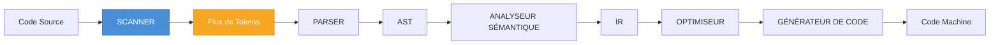
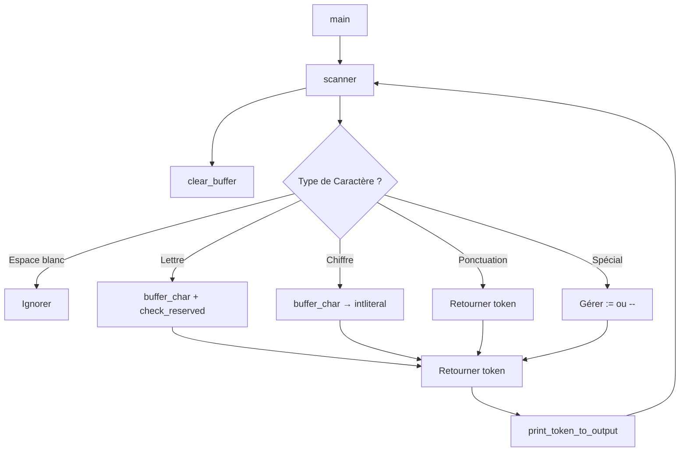
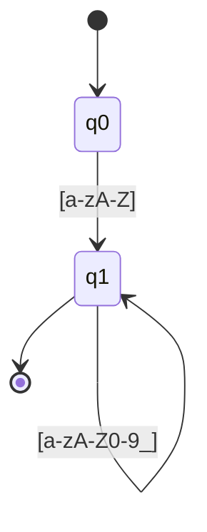

# Analyseur Lexical du Langage Micro

<div align="center">


**Un analyseur lexical pour le langage éducatif Micro**

*Démonstration des principes fondamentaux de l'analyse lexicale — la première phase de la compilation*

[Aperçu](#-aperçu) •
[Architecture](#-architecture--conception) •
[Compilation](#-compilation-de-lanalyseur) •
[Utilisation](#-exécution-de-lanalyseur) •
[Théorie](#-contexte-académique--théorie) •
[Extensions](#-extensions-suggérées-pour-la-recherche)

</div>

---

## 📋 Table des Matières

<details>
<summary>Cliquez pour développer</summary>

- [Aperçu](#-aperçu)
- [Structure du Projet](#-structure-du-projet)
- [Le Langage Micro](#-le-langage-micro)
- [Spécification des Tokens](#-spécification-des-tokens)
- [Architecture & Conception](#-architecture--conception)
- [Analyse Détaillée du Code](#-analyse-détaillée-du-code)
- [Compilation de l'Analyseur](#-compilation-de-lanalyseur)
- [Exécution de l'Analyseur](#-exécution-de-lanalyseur)
- [Exemples d'Entrées & Sorties Attendues](#-exemples-dentrées--sorties-attendues)
- [Comparaison avec les Compilateurs Réels](#-comparaison-avec-les-compilateurs-réels)
- [Contexte Académique & Théorie](#-contexte-académique--théorie)
- [Limitations & Problèmes Connus](#-limitations--problèmes-connus)
- [Extensions Suggérées](#-extensions-suggérées-pour-la-recherche)
- [Stratégie de Test](#-stratégie-de-test)
- [Licence & Remerciements](#-licence--remerciements)
- [Carte de Référence Rapide](#-carte-de-référence-rapide)

</details>

---

## 🔍 Aperçu

Ce projet implémente un **scanner** (aussi appelé *lexer* ou *tokenizer*) pour le langage **Micro**. Le scanner lit un fichier source écrit en Micro, le découpe en un flux de **tokens**, et écrit ce flux dans un fichier de sortie.

### Pipeline de Compilation



### Ce que le Scanner Reconnaît

| Catégorie | Éléments |
|-----------|----------|
| **Mots-clés** | `begin`, `end`, `read`, `write` |
| **Identificateurs** | `x`, `y`, `counter`, `_temp` |
| **Littéraux Entiers** | `52`, `0`, `001` |
| **Opérateurs** | `:=` (affectation), `+` (plus), `-` (moins) |
| **Ponctuation** | `(`, `)`, `;`, `,` |
| **Commentaires** | `--` jusqu'à la fin de ligne |
| **Marqueur EOF** | `SCANEOF` |

---

## 📁 Structure du Projet

```
.
├── 📄 scanner2.c          # L'implémentation principale du scanner
├── 🔧 scanner             # Binaire compilé (Linux/macOS)
├── 🔧 scanner2            # Binaire compilé alternatif
├── 📝 test.micro          # Programme Micro d'exemple (sans begin/end)
├── 📝 test1.micro         # Programme Micro d'exemple (avec begin/end)
├── 📤 output.txt          # Exemple de flux de tokens généré depuis test.micro
└── 📦 repomix-output.xml  # Représentation packagée du dépôt
```

> **Remarque :** `scanner` et `scanner2` sont des binaires compilés et ne sont pas lisibles par l'homme. Ils sont exclus de la représentation packagée.

---

## 🔤 Le Langage Micro

Micro est un langage impératif minimal utilisé dans les cours de construction de compilateurs, notamment inspiré du langage de *Compiler Construction: Principles and Practice* de Kenneth C. Louden.

### Grammaire

```ebnf
program     → "begin" stmt_list "end"
stmt_list   → stmt | stmt ";" stmt_list
stmt        → id ":=" expr
            | "read" "(" id_list ")"
            | "write" "(" expr_list ")"
expr        → term { ("+" | "-") term }
term        → factor { ("*" | "/") factor }
factor      → id | int_literal | "(" expr ")"
id_list     → id { "," id }
expr_list   → expr { "," expr }
```

### Conventions Lexicales

| Élément | Motif | Exemple |
|---------|-------|---------|
| Mot-clé | mot réservé | `begin`, `end` |
| Identificateur | `lettre (lettre \| chiffre \| _)*` | `x`, `a1`, `_t` |
| Entier | `chiffre+` | `52`, `0`, `001` |
| Affectation | `:=` | `:=` |
| Plus | `+` | `+` |
| Moins | `-` | `-` |
| Parenthèse Gauche | `(` | `(` |
| Parenthèse Droite | `)` | `)` |
| Point-virgule | `;` | `;` |
| Virgule | `,` | `,` |
| Commentaire | `--` … fin de ligne | `-- ceci est ok` |
| Espace blanc | espace, tabulation, saut de ligne | *(ignoré)* |

---

## 🏷️ Spécification des Tokens

Les tokens sont définis comme un `enum` en C :

```c
typedef enum {
    begin,       // mot-clé "begin"
    end,         // mot-clé "end"
    read,        // mot-clé "read"
    write,       // mot-clé "write"
    id,          // identificateur
    intliteral,  // littéral entier
    lparen,      // "("
    rparen,      // ")"
    semicolon,   // ";"
    comma,       // ","
    plusop,      // "+"
    minusop,     // "-"
    assignop,    // ":="
    scan_eof     // fin de l'entrée
} token;
```

Chaque token a un **type** et, pour les identificateurs et les littéraux entiers, un **lexème** associé stocké dans `token_buffer`.

---

## 🏗️ Architecture & Conception

Le scanner suit la conception classique **deux-tampons / basée sur getchar** décrite dans le *Dragon Book*.

### Techniques Fondamentales

| Technique | Objectif |
|-----------|----------|
| `fgetc(source)` | Entrée caractère par caractère |
| `ungetc(c, source)` | Lookahead d'un caractère |
| `token_buffer[256]` | Accumulation du lexème |
| `line_number` | Signalement des erreurs |

### Flux de Contrôle



### Lookahead & `ungetc`

Après avoir lu une lettre, le scanner continue à consommer des caractères tant qu'ils sont alphanumériques ou `_`. Quand il rencontre un caractère non correspondant, il le *repousse* avec `ungetc` pour que le prochain appel à `scanner()` puisse le traiter.

> C'est une forme simple de **lookahead d'un caractère** — la même technique utilisée dans les scanners écrits à la main des compilateurs réels (ex. `libcpp/lex.c` de GCC).

---

## 📖 Analyse Détaillée du Code

### 1. Inclusions d'En-têtes

```c
#include <stdio.h>    // FILE, fopen, fgetc, ungetc, fprintf, printf
#include <ctype.h>    // isspace, isalpha, isalnum, isdigit
#include <stdlib.h>   // exit (actuellement commenté)
#include <string.h>   // strlen, strcmp
```

### 2. État Global

```c
char token_buffer[256];
FILE *source;
FILE *output;
int line_number = 1;
```

| Variable | Rôle |
|----------|------|
| `token_buffer` | Contient le lexème courant (max 255 caractères + null) |
| `source` | Handle du fichier d'entrée |
| `output` | Handle du fichier de sortie |
| `line_number` | Suit la ligne courante pour les diagnostics |

### 3. Aides de Tampon

```c
void clear_buffer(void) { token_buffer[0] = '\0'; }

void buffer_char(int c) {
    int len = strlen(token_buffer);
    token_buffer[len] = (char)c;
    token_buffer[len + 1] = '\0';
}
```

> ⚠️ **Note de Performance :** `strlen` sur chaque caractère rend ceci O(n²) en longueur de lexème. Un scanner de production garderait plutôt un index. Voir [Limitations](#-limitations--problèmes-connus).

### 4. Reconnaissance des Mots-Clés

```c
token check_reserved(void) {
    if (strcmp(token_buffer, "begin") == 0) return begin;
    if (strcmp(token_buffer, "end")   == 0) return end;
    if (strcmp(token_buffer, "read")  == 0) return read;
    if (strcmp(token_buffer, "write") == 0) return write;
    return id;
}
```

Une séquence linéaire d'appels `strcmp`. Les compilateurs réels utilisent un **hash parfait** ou un **trie** pour une recherche O(1).

### 5. Gestion des Erreurs

```c
void lexical_error(int c) {
    printf("Erreur lexicale (ligne %d) : caractere inattendu '%c'\n",
           line_number, c);
    // exit(1);
}
```

Les erreurs sont signalées mais **n'arrêtent pas** le scanner — permettant la récupération et la poursuite du scan, comme dans les compilateurs de production.

### 6. Le Cœur : `scanner()`

```c
token scanner(void) {
    int in_char, c;
    clear_buffer();
    while ((in_char = fgetc(source)) != EOF) {
        if (in_char == '\n') { line_number++; continue; }
        if (isspace(in_char)) continue;

        else if (isalpha(in_char)) {
            buffer_char(in_char);
            for (c = fgetc(source); isalnum(c) || c == '_'; c = fgetc(source))
                buffer_char(c);
            ungetc(c, source);
            return check_reserved();
        }

        else if (isdigit(in_char)) {
            buffer_char(in_char);
            for (c = fgetc(source); isdigit(c); c = fgetc(source))
                buffer_char(c);
            ungetc(c, source);
            return intliteral;
        }

        else if (in_char == '(') return lparen;
        else if (in_char == ')') return rparen;
        else if (in_char == ';') return semicolon;
        else if (in_char == ',') return comma;
        else if (in_char == '+') return plusop;

        else if (in_char == '-') {
            c = fgetc(source);
            if (c == '-') {                      // commentaire
                do {
                    in_char = fgetc(source);
                } while (in_char != '\n' && in_char != EOF);
                if (in_char == '\n') line_number++;
            } else {
                ungetc(c, source);
                return minusop;
            }
        }

        else if (in_char == ':') {
            c = fgetc(source);
            if (c == '=') return assignop;
            else { ungetc(c, source); lexical_error(in_char); }
        }

        else { lexical_error(in_char); }
    }
    return scan_eof;
}
```

#### Observations Clés

| Fonctionnalité | Implémentation |
|----------------|----------------|
| Espace blanc | Ignoré, compteur de ligne incrémenté sur `\n` |
| Identificateurs | Début `isalpha`, puis `isalnum` / `_` |
| Entiers | Début `isdigit`, puis `isdigit` |
| Tokens à un caractère | `return` direct pour `( ) ; , +` |
| Opérateurs à deux caractères | `-` (commentaire ou moins), `:` + `=` → `:=` |
| Commentaires | `--` consommé jusqu'à la fin de ligne |
| EOF | `scan_eof` retourné |

> 🐛 **Alerte Bug :** La branche des commentaires ne fait **pas** de `return` ni de `continue` après avoir consommé le commentaire. Le contrôle tombe à la fin de la boucle `while` et lit le caractère suivant. En pratique cela fonctionne, mais c'est fragile. Voir [Limitations](#-limitations--problèmes-connus).

### 7. Fonctions de Sortie

`print_token` (vers stdout) et `print_token_to_output` (vers fichier) sont une logique dupliquée. Chacune mappe un `token` enum vers une chaîne lisible :

```c
case id:         fprintf(output, "ID(%s)\n", token_buffer); break;
case intliteral: fprintf(output, "INT(%s)\n", token_buffer); break;
```

> 💡 **Opportunité de Refactoring :** Ces deux fonctions pourraient être unifiées en prenant un paramètre `FILE *`.

### 8. `main()`

```c
int main(int argc, char *argv[]) {
    if (argc < 3) {
        printf("Usage : %s fichier_source fichier_output\n", argv[0]);
        return 1;
    }
    source = fopen(argv[1], "r");
    output = fopen(argv[2], "w");
    ...
    token t;
    do {
        t = scanner();
        print_token_to_output(t);
    } while (t != scan_eof);
    fclose(source); fclose(output);
    return 0;
}
```

CLI standard : `scanner <source> <sortie>`. La boucle se termine quand `scan_eof` est produit.

---

## 🔨 Compilation de l'Analyseur

### Prérequis

| Exigence | Détails |
|----------|---------|
| **Compilateur** | GCC, Clang ou MSVC |
| **Outil de build** | *(Optionnel)* `make` |
| **Shell** | POSIX-like (Linux, macOS, WSL, Git Bash) |

### Compilation

#### Avec GCC (Recommandé)

```bash
gcc -Wall -Wextra -O2 -o scanner scanner2.c
```

| Option | Objectif |
|--------|----------|
| `-Wall -Wextra` | Activer tous les avertissements |
| `-O2` | Optimiser pour la vitesse |
| `-o scanner` | Nom du binaire de sortie |

#### Avec Clang

```bash
clang -Wall -Wextra -O2 -o scanner scanner2.c
```

#### Build de Débogage (avec Sanitizers)

```bash
gcc -Wall -Wextra -g -fsanitize=address,undefined -o scanner_dbg scanner2.c
```

> ✅ **Fortement recommandé** pour le travail académique : détecte les débordements de tampon et les comportements indéfinis.

#### Windows (MSVC)

```cmd
cl scanner2.c /Fe:scanner.exe
```

#### Windows (MinGW)

```bash
gcc -Wall -Wextra -O2 -o scanner.exe scanner2.c
```

### Makefile Optionnel

```make
CC      = gcc
CFLAGS  = -Wall -Wextra -O2 -std=c11
TARGET  = scanner
SRC     = scanner2.c

all: $(TARGET)

$(TARGET): $(SRC)
	$(CC) $(CFLAGS) -o $@ $<

debug: $(SRC)
	$(CC) $(CFLAGS) -g -fsanitize=address,undefined -o $(TARGET)_dbg $<

clean:
	rm -f $(TARGET) $(TARGET)_dbg

.PHONY: all debug clean
```

Puis exécutez :

```bash
make          # build release
make debug    # build avec sanitizer
make clean    # supprimer les binaires
```

---

## 🚀 Exécution de l'Analyseur

### Utilisation de Base

```bash
./scanner test.micro output.txt
```

| Argument | Description |
|----------|-------------|
| `test.micro` | Fichier source Micro en entrée |
| `output.txt` | Destination du flux de tokens |

### Avec le Build Sanitizer

```bash
./scanner_dbg test.micro output.txt
```

### Inspection du Résultat

```bash
cat output.txt
```

### Exécution sous Windows

```cmd
scanner.exe test.micro output.txt
type output.txt
```

---

## 📊 Exemples d'Entrées & Sorties Attendues

### Entrée : `test.micro`

```micro
x := 52;
y := 3 + 4;
z := 10;
w := 0.001;
a := x + y;
```

### Sortie : `output.txt`

```
[ligne 1] ID(x)
[ligne 1] ASSIGNOP
[ligne 1] INT(52)
[ligne 1] SEMICOLON
[ligne 2] ID(y)
[ligne 2] ASSIGNOP
[ligne 2] INT(3)
[ligne 2] PLUSOP
[ligne 2] INT(4)
[ligne 2] SEMICOLON
[ligne 3] ID(z)
[ligne 3] ASSIGNOP
[ligne 3] INT(10)
[ligne 3] SEMICOLON
[ligne 4] ID(w)
[ligne 4] ASSIGNOP
[ligne 4] INT(0)
[ligne 4] INT(001)
[ligne 4] SEMICOLON
[ligne 5] ID(a)
[ligne 5] ASSIGNOP
[ligne 5] ID(x)
[ligne 5] PLUSOP
[ligne 5] ID(y)
[ligne 5] SEMICOLON
[ligne 5] SCANEOF
```

> **Observation :** La ligne 4 (`w := 0.001;`) est tokenisée comme `INT(0)` suivi de `INT(001)`. Le scanner ne supporte **pas** les littéraux flottants ni le caractère `.`. C'est une limitation délibérée du langage Micro, qui souligne une leçon importante : **le comportement du scanner est entièrement déterminé par la spécification lexicale du langage.**

### Entrée : `test1.micro`

```micro
begin
x := 5.2;
y := 3 + 4;
z := 10;
w := 0.001;
a := x + y;
end
```

> ⚠️ **Comportement Attendu :** `begin` et `end` sont reconnus comme mots-clés (retournés par `check_reserved`), mais le `switch` de `print_token_to_output` **n'a pas de cas pour `begin` et `end`**, donc ils tombent dans la branche `default:` et affichent `ERREUR`. C'est un **bug** — voir [Limitations](#-limitations--problèmes-connus).

---

## ⚖️ Comparaison avec les Compilateurs Réels

| Aspect | Ce Scanner | GCC / Clang / MSVC | Compilateur Java (`javac`) |
|--------|-----------|-------------------|----------------------------|
| **Générateur de Lexer** | Écrit à la main | Écrit à la main (GCC), piloté par table (Clang) | Écrit à la main (Unicode-aware) |
| **Encodage des Caractères** | ASCII uniquement | UTF-8, UTF-16, UTF-32, sensible à la locale | Unicode complet |
| **Lookahead** | 1 caractère (`ungetc`) | 1–2 caractères, parfois arbitraire | Illimité via `Reader` |
| **Recherche de Mots-Clés** | Chaîne `strcmp` linéaire | Hash parfait / trie | Table de hachage |
| **Gestion de Tampon** | Tampon fixe de 256 octets | Extensible, mappé en mémoire, basé sur sentinelle | `StringBuilder` extensible |
| **Récupération d'Erreur** | Affiche l'erreur, continue | Affiche l'erreur, continue, resynchronise | Affiche l'erreur, continue |
| **Commentaires** | `--` jusqu'à fin de ligne | `//`, `/* */`, `#`, `--` | `//`, `/* */`, `/** */` |
| **Littéraux Numériques** | Entiers uniquement | Entiers, flottants, hex, octal, binaire | Entiers, flottants, hex, octal, binaire |
| **Littéraux Chaînes** | Non supportés | Supportés, échappements, raw strings | Supportés, échappements, text blocks |
| **Préprocesseur** | Aucun | Préprocesseur C complet | Aucun (annotations à la place) |
| **Suivi de Position** | Ligne uniquement | Ligne + colonne + fichier | Ligne + colonne + fichier |
| **Performance** | ~µs par token | ~ns par token | ~ns par token |
| **Conformité Standard** | Ad-hoc | ISO C / ISO C++ | JLS |
| **Tests** | Manuels | Suites massives, fuzzing | Suites massives, JCK |

### Comparaisons Approfondies

#### 1. Générateurs de Lexer vs. Scanners Écrits à la Main

Les compilateurs réels utilisent rarement des outils comme **Lex/Flex** pour leur lexer principal :

| Compilateur | Emplacement du Lexer | Approche |
|-------------|----------------------|----------|
| **GCC** | `libcpp/lex.c` | Écrit à la main pour la performance |
| **Clang** | `clang/lib/Lex/` | Écrit à la main, piloté par table |
| **Java** | `src/jdk.compiler/.../Scanner.java` | Écrit à la main |

Les scanners écrits à la main sont préférés car :
- Ils gèrent plus facilement les cas sensibles au contexte (ex. `>>` dans les templates C++ vs. opérateur de décalage).
- Ils sont plus rapides (pas de surcharge de lookup de table dans le chemin critique).
- Ils s'intègrent mieux avec le parseur (ex. retour du parseur vers le lexer).

> Ce projet est un **scanner écrit à la main**, s'alignant sur la pratique industrielle.

#### 2. Représentation des Tokens

| Approche | Ce Projet | Compilateurs Réels |
|----------|-----------|---------------------|
| **Type** | `enum` | Struct/classe riche |
| **Lexème** | `token_buffer` global | Stocké dans le token |
| **Position** | `line_number` global | `SourceLocation` (fichier, ligne, colonne) |
| **Valeur** | Tampon global | Union/`std::variant` |

```c
// Token Clang simplifié
class Token {
    tok::TokenKind Kind;     // type de token
    SourceLocation Location; // fichier, ligne, colonne
    const char *Spelling;    // lexème
    ...
};
```

> La leçon : **les tokens doivent porter la position source et le lexème**, pas dépendre de globales.

#### 3. Récupération d'Erreur

Les compilateurs réels distinguent :
- **Erreurs lexicales** — signalées, ignorées
- **Erreurs syntaxiques** — signalées, le parseur resynchronise
- **Erreurs sémantiques** — signalées, peut continuer

Ce scanner ne gère que les erreurs lexicales, et encore, il ne fait que les afficher. Un scanner de production maintiendrait une liste d'erreurs, utiliserait un objet `Diagnostic` avec des niveaux de sévérité, et supporterait `#pragma` et la suppression.

#### 4. Unicode et Locale

`isalpha` et `isdigit` sont **sensibles à la locale** et ne gèrent que l'ASCII par défaut. Les compilateurs réels utilisent des bases de données de caractères Unicode (ex. ICU), supportent des identificateurs comme `café`, `变量`, `переменная`, et gèrent les formes de normalisation (NFC, NFD).

#### 5. Considérations de Performance

| Technique | Ce Scanner | Lexers de Production |
|-----------|-----------|----------------------|
| Classification de caractères | `ctype.h` | Tables de lookup, SIMD |
| Croissance de tampon | Fixe 256 | Dynamique, doublement |
| Recherche de mots-clés | `strcmp` | Hash parfait, trie |
| I/O | `fgetc` | Fichiers mappés en mémoire, lectures tamponnées |
| Allocation de tokens | Pile/globale | Allocateurs d'arène |

> Un lexer de production peut tokeniser **des millions de tokens par seconde**. Ce scanner est des ordres de grandeur plus lent, mais sa simplicité est sa force pédagogique.

---

## 📚 Contexte Académique & Théorie

### Le Rôle du Scanner dans la Compilation

Le scanner effectue l'**analyse lexicale** : convertir un flux de caractères en un flux de tokens. C'est la **première phase** de la compilation et il interface directement avec le **parseur** (analyse syntaxique).

Formellement, le scanner implémente un reconnaisseur de **langage régulier**. Chaque classe de token est décrite par une **expression régulière**, qui est compilée en un **automate fini** (DFA ou NFA). Le scanner est essentiellement un **simulateur de DFA**.

### Expressions Régulières pour les Tokens Micro

| Token | Expression Régulière |
|-------|---------------------|
| `begin` | `begin` |
| `end` | `end` |
| `read` | `read` |
| `write` | `write` |
| `id` | `[a-zA-Z][a-zA-Z0-9_]*` |
| `intliteral` | `[0-9]+` |
| `assignop` | `:=` |
| `plusop` | `+` |
| `minusop` | `-` |
| `lparen` | `(` |
| `rparen` | `)` |
| `semicolon` | `;` |
| `comma` | `,` |
| commentaire | `--[^\n]*` |
| espace blanc | `[ \t\n]+` |

### Automate Fini pour les Identificateurs



- `q0` est l'état initial
- `q1` est l'état acceptant
- Le scanner implémente ce DFA implicitement via la boucle `isalpha` / `isalnum`

### La Règle du Plus Long Match

Le scanner suit la règle du **plus long match** (maximal munch) : il consomme autant de caractères que possible tout en correspondant à un token.

| Entrée | Tokenisation | Raison |
|--------|--------------|--------|
| `:=` | `ASSIGNOP` | Préféré à `:` puis `=` |
| `123abc` | `INT(123)` puis `ID(abc)` | Les chiffres arrêtent l'entier, une lettre démarre un identificateur |

> Cette règle est universelle dans tous les compilateurs (C, C++, Java, Python, etc.).

### Références

1. Aho, A. V., Lam, M. S., Sethi, R., & Ullman, J. D. (2006). *Compilers: Principles, Techniques, and Tools* (2nd ed.). Pearson. — **Le Dragon Book**, Chapitres 3.1–3.4.
2. Louden, K. C. (1997). *Compiler Construction: Principles and Practice*. PWS Publishing. — Origine du langage Micro.
3. Levine, J. R. (2009). *Flex & Bison*. O'Reilly Media.
4. Parr, T. (2013). *The Definitive ANTLR 4 Reference*. Pragmatic Bookshelf.
5. Source GCC : `libcpp/lex.c`, `gcc/cp/lex.c`.
6. Source Clang : `clang/lib/Lex/Lexer.cpp`.
7. Source OpenJDK : `src/jdk.compiler/share/classes/com/sun/tools/javac/parser/Scanner.java`.

---

## ⚠️ Limitations & Problèmes Connus

### 1. Cas de Mots-Clés Manquants dans la Sortie

`print_token_to_output` n'a pas de `case begin:` ni `case end:`. En conséquence, `begin` et `end` tombent dans `default:` et affichent `ERREUR`.

**Correction :**

```c
case begin:  fprintf(output, "BEGIN\n");  break;
case end:    fprintf(output, "END\n");    break;
case read:   fprintf(output, "READ\n");   break;
case write:  fprintf(output, "WRITE\n");  break;
```

### 2. Ajout O(n²) au Tampon

`buffer_char` appelle `strlen` sur chaque caractère. Pour de longs identificateurs ou nombres, c'est quadratique.

**Correction :**

```c
int token_len = 0;
void clear_buffer(void) { token_len = 0; token_buffer[0] = '\0'; }
void buffer_char(int c) { token_buffer[token_len++] = (char)c; token_buffer[token_len] = '\0'; }
```

### 3. Tampon de Taille Fixe (256 octets)

Des lexèmes plus longs causent un **débordement de tampon**.

**Correction :** Vérifier les bornes dans `buffer_char`, ou utiliser une allocation dynamique.

### 4. `ungetc` ne Garantit qu'un Caractère

`ungetc` n'est garanti de repousser qu'**un** caractère par le standard C. En repousser plus est défini par l'implémentation. Ce scanner n'en repousse qu'un à la fois, donc c'est sûr, mais c'est une contrainte à retenir.

### 5. Pas de Suivi de Colonne

Seul `line_number` est suivi. Les compilateurs réels signalent `ligne:colonne` pour les diagnostics.

**Correction :** Ajouter `int column = 1;` et incrémenter à chaque `fgetc`.

### 6. Pas de Gestion de `read`/`write` dans le Switch de Sortie

Même problème que pour les mots-clés — ces tokens sont retournés par `check_reserved` mais non affichés.

### 7. Chute à Travers le Commentaire

Après avoir consommé un commentaire, le code ne fait ni `continue` ni `return`. Il tombe à la fin du corps du `while`, puis boucle. Cela fonctionne mais n'est pas clair.

**Correction :** `continue;` après la boucle de commentaire.

### 8. Pas de Gestion de `*`, `/`, `=`, `<`, `>`

Le langage Micro tel que spécifié ici ne les inclut pas, mais si le langage est étendu, le scanner doit être mis à jour.

### 9. Pas de Support des Flottants

`0.001` est tokenisé comme deux entiers. Si Micro est étendu pour supporter les flottants, le scanner a besoin d'un token `floatliteral` et d'un gestionnaire pour `.`.

### 10. État Global

`source`, `output`, `token_buffer` et `line_number` sont des globales. Cela rend le scanner non-réentrant et difficile à tester.

**Correction :** Encapsuler dans une `struct Scanner`.

---

## 🔬 Extensions Suggérées pour la Recherche

| # | Extension | Description |
|---|-----------|-------------|
| 1 | **Ajouter un Parseur** | Utiliser la descente récursive ou yacc/bison pour construire un parseur au-dessus du scanner |
| 2 | **Ajouter une Table des Symboles** | Suivre les identificateurs et leurs attributs (type, portée, valeur) |
| 3 | **Ajouter la Vérification de Type** | Étendre Micro avec les types `int` et `float`, implémenter un vérificateur de type |
| 4 | **Générer du Code Intermédiaire** | Émettre du code à trois adresses ou un IR simple basé sur une pile |
| 5 | **Ajouter le Support Unicode** | Remplacer `isalpha`/`isdigit` par des fonctions Unicode-aware |
| 6 | **Ajouter un Générateur de Lexer** | Implémenter un petit outil type Lex qui lit des regex et produit un DFA |
| 7 | **Comparer avec les Compilateurs Réels** | Utiliser `perf` ou `valgrind` pour profiler le scanner |
| 8 | **Tests par Fuzzing** | Utiliser AFL ou libFuzzer pour fuzzer le scanner avec des entrées aléatoires |
| 9 | **Vérification Formelle** | Modéliser le scanner en Coq ou TLA+ et prouver des propriétés |
| 10 | **Stratégies de Récupération d'Erreur** | Implémenter le mode panique, la récupération au niveau phrase et les productions d'erreur |
| 11 | **Scan Parallèle** | Explorer le lexing parallèle en divisant l'entrée en morceaux |
| 12 | **Scan Incrémental** | Implémenter un lexer incrémental pour une utilisation dans un IDE |

---

## 🧪 Stratégie de Test

### Tests Unitaires

Créer un ensemble de fichiers `.micro`, chacun testant une fonctionnalité :

| Fichier | Tests |
|---------|-------|
| `test_keywords.micro` | `begin`, `end`, `read`, `write` |
| `test_ids.micro` | Identificateurs avec `_` et chiffres |
| `test_ints.micro` | Entiers, zéros en tête |
| `test_ops.micro` | `:=`, `+`, `-` |
| `test_punct.micro` | `(`, `)`, `;`, `,` |
| `test_comments.micro` | Commentaires `--` |
| `test_errors.micro` | Caractères illégaux |
| `test_empty.micro` | Fichier vide |
| `test_eof.micro` | Fichier sans nouvelle ligne finale |

### Tests de Référence (Golden)

Pour chaque entrée, stocker la sortie attendue. Lancer le scanner et comparer :

```bash
./scanner test_keywords.micro out.txt
diff out.txt expected/test_keywords.out
```

### Tests avec Sanitizers

Lancer tous les tests sous ASan/UBSan :

```bash
make debug
for f in tests/*.micro; do ./scanner_dbg "$f" /dev/null; done
```

### Fuzzing

```bash
# Avec AFL
afl-gcc -o scanner_afl scanner2.c
afl-fuzz -i seeds/ -o findings/ ./scanner_afl @@ /dev/null
```

### Intégration Continue

Ajouter un `.github/workflows/ci.yml` pour compiler et tester sur Linux, macOS et Windows.

---

## 📜 Licence & Remerciements

Ce projet est une implémentation éducative d'un scanner pour le langage **Micro**, inspiré par :

- Kenneth C. Louden, *Compiler Construction: Principles and Practice*.
- Aho, Lam, Sethi, Ullman, *Compilers: Principles, Techniques, and Tools*.

Il est destiné à un **usage académique**. N'hésitez pas à forker, étendre et utiliser dans des cours de construction de compilateurs.

### Citation Suggérée

```bibtex
@misc{micro_scanner,
  title  = {Analyseur Lexical du Langage Micro},
  author = {Anonyme},
  year   = {2024},
  note   = {Analyseur lexical éducatif en C},
  url    = {https://github.com/example/micro-scanner}
}
```

---

## 🗂️ Carte de Référence Rapide

### Commandes de Compilation

```bash
# Compiler
gcc -Wall -Wextra -O2 -o scanner scanner2.c

# Exécuter
./scanner test.micro output.txt

# Voir la sortie
cat output.txt

# Build de débogage
gcc -g -fsanitize=address,undefined -o scanner_dbg scanner2.c
./scanner_dbg test.micro output.txt
```

### Référence des Tokens

| Token | Chaîne de Sortie | Exemple |
|-------|------------------|---------|
| Identificateur | `ID(name)` | `ID(x)` |
| Entier | `INT(value)` | `INT(52)` |
| `:=` | `ASSIGNOP` | |
| `+` | `PLUSOP` | |
| `-` | `MINUSOP` | |
| `(` | `LPAREN` | |
| `)` | `RPAREN` | |
| `;` | `SEMICOLON` | |
| `,` | `COMMA` | |
| EOF | `SCANEOF` | |

### Problèmes Courants

| Problème | Solution |
|----------|----------|
| `begin`/`end` affichent `ERREUR` | Ajouter des cas au switch de sortie |
| Débordement de tampon | Augmenter la taille de `token_buffer` ou vérifier les bornes |
| Lent sur de longs identificateurs | Remplacer `strlen` par un compteur d'index |

---

<div align="center">

**⭐ Star ce dépôt si tu le trouves utile ! ⭐**

*Fait avec ❤️ pour l'enseignement de la construction de compilateurs*

[Retour en Haut](#analyseur-lexical-du-langage-micro)

</div>
